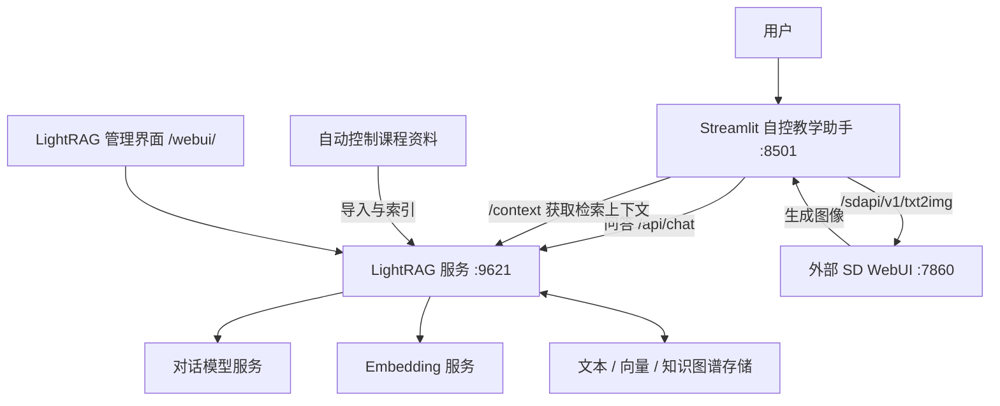

# ControlRAG · 自控知识教学助手

面向自动控制课程学习与教学的 AI 辅助工具，也是本毕业设计的主要实现。项目基于 **LightRAG**，将自动控制领域资料组织为可检索的文本、实体和关系，在此基础上提供知识问答、检索关系可视化与辅助图像生成。

ControlRAG 基于 LightRAG 1.3.6 进行开发，核心源码位于本仓库。教学交互界面使用 Streamlit，知识检索与问答服务使用 LightRAG/FastAPI。Stable Diffusion WebUI 是独立的第三方服务，本仓库不包含其程序、模型权重或本地整合包，仅提供接入配置说明。

## 功能介绍

- **自动控制知识问答**：围绕传递函数、反馈系统、稳定性、根轨迹、频率响应、PID 等课程知识，结合已导入资料生成回答。
- **多种检索方式**：支持局部、全局、向量检索及组合检索，也支持跳过知识库直接对话。
- **流式对话**：逐步显示回答，保存当前 Streamlit 会话中的对话记录与时间戳。
- **知识关系展示**：提取检索上下文中的实体与关系，以交互式有向图展示知识点之间的联系。
- **辅助文生图**：将 AI 回答作为提示词调用外部 SD WebUI，在聊天页面显示生成图像。
- **知识库管理**：通过 LightRAG 自带的管理界面或 API 导入资料、查看处理状态、浏览图谱及测试检索。

本项目用于课程知识辅助学习。当前代码中的图像生成是通用文生图，未实现控制系统数值仿真、PID 自动整定或 Simulink 模型生成。

## 系统结构



SD 的接入已经写在 `streamlit.py` 中：在同一台机器上启动支持 AUTOMATIC1111 API 的 WebUI 服务，并保持地址为 `http://127.0.0.1:7860`，教学界面即可调用。这里通过 HTTP API 连接两个服务，无需额外配置端口转发或代理。

## 目录说明

```text
ControlRAG/
├── README.md                         # 本项目介绍与部署说明
├── README.upstream.md                # 原 LightRAG 英文说明
├── README-zh.md                      # 原 LightRAG 中文说明
├── .env.example                      # 脱敏配置模板
├── streamlit.py                      # 自控教学助手入口
├── lightrag/
│   ├── api/                          # FastAPI 后端、路由与管理页面
│   ├── llm/                          # 对话模型与 Embedding 接入
│   ├── kg/                           # 图谱、向量和文档存储实现
│   └── operate.py                    # 检索与上下文组织
├── lightrag_webui/                   # 管理界面 React/TypeScript 源码
├── server/
│   ├── .env.example                  # 脱敏模板，与根目录模板相同
│   ├── .env                          # 本地运行配置，不提交
│   ├── inputs/                       # 已构建知识库的课程资料
│   └── rag_storage/                  # 预构建索引、知识图谱与缓存
├── docs/                             # 技术文档
├── setup.py                          # 安装配置与命令行入口
└── LICENSE                           # LightRAG 上游 MIT 许可证
```

SD 整合包与压缩包均不在本仓库发布范围内，也不参与本项目源码部署。

## 环境准备

- LightRAG 与教学界面：建议使用 **Python 3.11**，并创建独立虚拟环境。服务端代码使用了 `match/case`，需要 Python 3.10 或更高版本。
- 模型服务：需要可用的对话模型和 Embedding 模型，支持代码已接入的 OpenAI 兼容接口或 Ollama。
- SD 生图：按 SD WebUI 官方说明独立安装，使用其支持的 Python、PyTorch 和硬件环境；模型权重自行准备。
- 管理界面源码构建：仅在缺少构建产物或修改前端时需要 Bun。

以下命令以 **Windows PowerShell** 为例。首次进入仓库时执行 `cd .\ControlRAG`；若终端已位于仓库根目录，可跳过该命令。

## 安装与配置 LightRAG

### 1. 安装项目及教学界面依赖

```powershell
cd .\ControlRAG
py -3.11 -m venv .venv
.\.venv\Scripts\Activate.ps1
python -m pip install --upgrade pip
python -m pip install -e ".[api]"
python -m pip install streamlit streamlit-agraph requests
```

使用本目录的可编辑安装，以运行本项目中的代码。不要直接用上游最新版替换当前目录；上游更新可能涉及接口和配置变化。

### 2. 配置模型与存储

LightRAG 从**启动命令所在的工作目录**读取 `.env`。本项目统一从 `ControlRAG/server/` 启动，以使用该目录下的配置、输入资料和索引。

首次配置且 `server/.env` 不存在时，可复制模板：

```powershell
Copy-Item .\.env.example .\server\.env
```

已有 `.env` 时直接编辑，保留自己的有效配置。下面给出 OpenAI 兼容服务的配置示例，尖括号内容需要替换为实际值：

```dotenv
HOST=127.0.0.1
PORT=9621
WORKING_DIR=./rag_storage
INPUT_DIR=./inputs

LLM_BINDING=openai
LLM_MODEL=<你的对话模型名称>
LLM_BINDING_HOST=<对话服务的完整 API 基础地址>
LLM_BINDING_API_KEY=<你的对话服务密钥>

EMBEDDING_BINDING=openai
EMBEDDING_MODEL=<你的向量模型名称>
EMBEDDING_BINDING_HOST=<向量服务的完整 API 基础地址>
EMBEDDING_BINDING_API_KEY=<你的向量服务密钥>
EMBEDDING_DIM=1536

SUMMARY_LANGUAGE=English
LIGHTRAG_KV_STORAGE=JsonKVStorage
LIGHTRAG_VECTOR_STORAGE=NanoVectorDBStorage
LIGHTRAG_GRAPH_STORAGE=NetworkXStorage
LIGHTRAG_DOC_STATUS_STORAGE=JsonDocStatusStorage
```

`EMBEDDING_DIM=1536` 只是示例，必须与所选向量模型的实际输出维度一致。对话与向量服务分别配置；即使使用同一服务，也应分别填写 `LLM_BINDING_HOST` 和 `EMBEDDING_BINDING_HOST`。

如使用本地 Ollama，可将对应模型配置改为下列形式，并提前在 Ollama 中下载所需模型：

```dotenv
LLM_BINDING=ollama
LLM_BINDING_HOST=http://localhost:11434
LLM_MODEL=<已下载的对话模型名称>
EMBEDDING_BINDING=ollama
EMBEDDING_BINDING_HOST=http://localhost:11434
EMBEDDING_MODEL=<已下载的向量模型名称>
EMBEDDING_DIM=<该向量模型的实际输出维度>
```

默认存储组合使用本地文件，无需另行部署 Neo4j、Milvus 等数据库。复用 `rag_storage/` 时，应保持原有向量模型及维度；更换向量模型应使用新的工作目录并重新导入资料。

### 3. 启动 LightRAG 后端

在已激活虚拟环境的终端中执行：

```powershell
cd .\server
lightrag-server --host 127.0.0.1 --port 9621
```

启动后可访问：

| 地址 | 用途 |
| --- | --- |
| `http://localhost:9621/health` | 服务健康检查 |
| `http://localhost:9621/docs` | API 文档与接口调试 |
| `http://localhost:9621/webui/` | LightRAG 管理界面 |
| `http://localhost:9621/api/tags` | 教学界面读取的兼容模型列表 |

### 4. 导入自动控制资料

可以在管理界面上传资料，也可以将 UTF-8 编码的 `.txt`、`.md` 等资料放入 `server/inputs/` 后触发扫描：

```powershell
Invoke-RestMethod -Method Post -Uri http://localhost:9621/documents/scan
```

也可以在启动后端时增加 `--auto-scan-at-startup`，自动扫描输入目录。资料入库涉及文本分块、实体关系抽取和向量化，首次导入需要等待后台处理完成，再进行知识库问答。

仓库附带已构建的自动控制课程知识库：`server/inputs/Markdown_nofigure.md` 是入库资料，`server/rag_storage/` 包含文档、文本分块、知识图谱、向量索引及处理缓存。目前索引包含 727 条文本块向量、3631 条实体向量和 4473 条关系向量，向量维度为 1536。

复用现成索引时，从 `server/` 启动服务，并将 Embedding 配置为原知识库使用的 `text-embedding-3-small`、1536 维；仅维度相同不能保证不同向量模型兼容。填好自己的模型服务地址和密钥后，可以直接检索，无需重复导入。对话模型和向量模型通过服务接口调用，预构建向量索引不是模型权重。

若要更换向量模型或重新构建知识库，请将 `WORKING_DIR` 指向新的目录后导入资料，保留原索引作为备份。

## 配置外部 SD WebUI

本项目通过 **AUTOMATIC1111 Stable Diffusion WebUI API** 接入图像生成。请从[官方开源仓库](https://github.com/AUTOMATIC1111/stable-diffusion-webui)独立安装，模型放置与环境安装按该项目说明完成。

完成安装后，在 SD WebUI 的 `webui-user.bat` 中设置启动参数；如已有其他参数，在原参数后追加：

```bat
set COMMANDLINE_ARGS=--api --port 7860
```

然后启动 SD WebUI：

```powershell
.\webui-user.bat
```

`--api` 开启调用接口，`--port 7860` 与本项目代码中的地址保持一致。详细说明见官方 [API 文档](https://github.com/AUTOMATIC1111/stable-diffusion-webui/wiki/API)和[启动参数说明](https://github.com/AUTOMATIC1111/stable-diffusion-webui/wiki/Command-Line-Arguments-and-Settings)。

确认 SD 已加载可用模型，并检查以下地址：

- `http://127.0.0.1:7860/docs`：API 文档。
- `http://127.0.0.1:7860/sdapi/v1/sd-models`：模型列表。

项目会读取模型、采样器和配置接口，并调用 `/sdapi/v1/txt2img` 生成图像。SD 服务就绪后，启动教学界面即可使用，不需要把 SD 程序放入本仓库。

## 启动自控教学助手

保持 LightRAG 后端与 SD WebUI 运行，打开另一个 PowerShell 终端，从仓库的上一级目录执行：

```powershell
cd .\ControlRAG
.\.venv\Scripts\Activate.ps1
streamlit run .\streamlit.py --server.port 8501
```

浏览器打开 `http://localhost:8501`，即可进入“自控教学助手”。

1. 选择回答模式并输入自动控制相关问题。
2. 勾选“启用知识图谱”，显示检索相关实体及其关系。
3. 勾选“启用文生图功能”，在回答后调用 SD 生成辅助图像。

示例问题：

- 闭环反馈如何影响系统的稳态误差？
- 如何通过根轨迹分析闭环系统的稳定性？
- 比较 PID 控制器中比例、积分和微分环节的作用。

### 服务地址对应关系

| 服务 | 默认地址 | 配置位置 |
| --- | --- | --- |
| 教学界面 | `http://localhost:8501` | Streamlit 启动参数 |
| LightRAG 后端 | `http://localhost:9621` | `server/.env` 或后端启动参数 |
| SD WebUI API | `http://127.0.0.1:7860` | SD 启动参数 |
| 实际对话 / 向量模型服务 | 由所用服务决定 | `server/.env` |

`streamlit.py` 中的 `OLLAMA_URL` 和 `MODEL_MANAGEMENT_URL` 指向的是 LightRAG 提供的 **Ollama 兼容接口**，实际使用的对话模型由后端 `.env` 决定。使用其他模型服务时，也应让教学界面继续连接 LightRAG 的 `9621` 端口。

若修改 LightRAG 端口，需要同步修改这两个常量；若 SD 不在本机 `7860` 运行，需要同步修改 `streamlit.py` 中所有 `http://127.0.0.1:7860` 地址。

## 当前实现说明

- **回答模式**：侧栏的“混合 / 局部 / 混合成 / 原生 / 全局 / 仅聊天”分别意图对应 `mix / local / hybrid / naive / global / bypass`。当前“混合”选项不添加 `/mix` 前缀，因此实际使用后端默认的 `hybrid`；如需明确使用 `mix`，可在问题前手动加 `/mix `。
- **模型选择**：教学界面读取的是 LightRAG 的模拟模型标签，不直接切换后端实际模型。实际对话模型应通过 `.env` 配置并重启后端。
- **生图参数**：侧栏提供模型和采样参数控件，但当前调用为 `generate_image(response)`，尚未传入侧栏参数，也未提交模型切换请求。实际生图使用函数默认参数：Euler a、20 步、CFG 7、512 × 512；基础模型由 SD 当前加载的模型决定。
- **SD 连接**：侧栏初始化会读取 SD 模型和采样器，即使未勾选生图，SD 未启动时也可能显示连接提示。完整演示建议先启动 SD。
- **知识图谱**：聊天页面展示的是检索上下文中提取出的关系，完整知识库图谱可在 LightRAG 管理界面查看。

## 常见问题

| 现象 | 检查方式 |
| --- | --- |
| 无法连接问答服务 | 检查 LightRAG 是否运行于 `9621`，并访问 `/health` |
| 找不到配置或知识库为空 | 确认从 `server/` 启动，检查 `.env`、`inputs/` 与 `rag_storage/`，并等待文档处理完成 |
| 模型请求失败 | 分别检查对话与 Embedding 服务地址、模型名称、密钥及服务可用性 |
| 向量维度不匹配 | 核对 `EMBEDDING_DIM`；换用向量模型后使用新的索引目录重新入库 |
| SD 连接失败或生图接口不存在 | 确认 SD 启动参数包含 `--api --port 7860`，并访问其 `/docs` |
| SD 模型列表为空 | 检查模型权重是否已按 SD 官方说明放置并成功加载 |
| 侧栏参数改变但生图不变 | 当前调用未传递这些参数，详见“当前实现说明” |
| 管理界面缺少页面文件 | 按下方步骤构建管理前端，再重启后端 |

如需构建 LightRAG 管理界面，在安装 Bun 后，从 `ControlRAG/` 执行：

```powershell
cd .\lightrag_webui
bun install --frozen-lockfile
bun run build --emptyOutDir
```

构建产物输出到 `lightrag/api/webui/`。Streamlit 教学界面的运行不需要构建这个 React 前端。

## 开源来源与发布范围

- 本项目基于 [HKUDS/LightRAG](https://github.com/HKUDS/LightRAG)，保留其代码及许可证；上游 MIT 许可见 [`LICENSE`](./LICENSE)。
- 图像生成依赖外部 [AUTOMATIC1111/stable-diffusion-webui](https://github.com/AUTOMATIC1111/stable-diffusion-webui)，遵循其自身许可证与模型使用条款。本仓库仅提供 API 接入代码和配置说明。
- GitHub 发布内容包含项目源码、配置模板，以及已构建的课程知识库和索引。真实 `.env`、密钥、SD 程序整合包、压缩包、虚拟环境和运行日志不提交。外部模型的发布方式以仓库中的实际模型说明为准。
